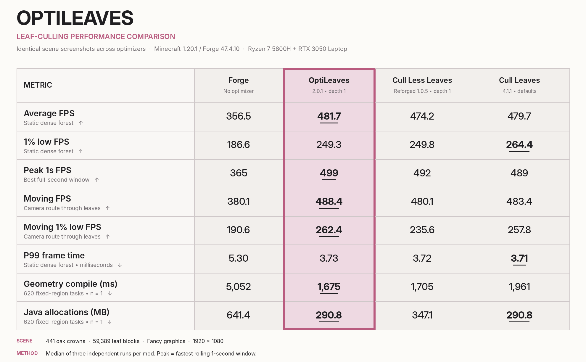

# OptiLeaves performance benchmark

Measured on 14 October 2026. This benchmark compares leaf-culling optimizers at settings that produced identical screenshots in the tested scenes.

[Back to the project README](../README.md)

## Test setup

- **Platform:** Minecraft 1.20.1 / Forge 47.4.10, Ryzen 7 5800H + RTX 3050 Laptop, Java 17, 1920×1080, Fancy leaves, view distance 8.
- **Mods:** one variant per test process, with no shaders or extra renderer optimizer. Forge alone is the unoptimized reference.
- **Scene:** a constructed 441-crown oak forest containing 59,389 leaf blocks; not a typical naturally generated biome.
- **Visual settings:** OptiLeaves 2.0.1 with `depth=1`, Cull Less Leaves Reforged 1.0.5 with `depth=1`, and Cull Leaves 4.1.1 at defaults.
- **Protocol:** three independent processes per variant in a fixed, interleaved order, with 25-second measurement windows after warmup.

## Results

| Metric | Forge baseline | **OptiLeaves** | CLLR | Cull Leaves |
|:--|--:|--:|--:|--:|
| Average FPS ↑ | 356.5 | **481.7** | 474.2 | 479.7 |
| 1% low FPS ↑ | 186.6 | 249.3 | 249.8 | **264.4** |
| Peak 1s FPS ↑ | 365 | **499** | 492 | 489 |
| Moving FPS ↑ | 380.1 | **488.4** | 480.1 | 483.4 |
| Moving 1% low FPS ↑ | 190.6 | **262.4** | 235.6 | 257.8 |
| P99 frame time ↓ | 5.30 | 3.73 | 3.72 | **3.71** |
| Geometry compile (ms) ↓ | 5,052 | **1,675** | 1,705 | 1,961 |
| Java allocations (MB) ↓ | 641.4 | **290.8** | 347.1 | **290.8** |

*Bold numbers identify the best displayed result in each row (including rounded ties), not a statistically proven winner. Primary FPS and frame-time results show the median of three independent runs. Peak FPS is the fastest rolling one-second window (not the maximum of one frame). The bottom two rows are supplementary, independently-run fixed-region controls with 620 compile tasks **per variant, n=1**.*

**Image parity:** All three leaf-optimizing variants produced pixel-identical RGB screenshots in the measured scenes.

## Run-level FPS (every process, no selected-best-run filtering)

| Mod | Run | Static FPS | Static 1% low | Moving FPS | Moving 1% low | Control FPS |
|:--|--:|--:|--:|--:|--:|--:|
| baseline | 1 | 355.9 | 186.6 | 380.1 | 190.3 | 512.7 |
| baseline | 2 | 368.4 | 170.7 | 377.7 | 190.6 | 516.7 |
| baseline | 3 | 356.5 | 188.0 | 384.6 | 197.3 | 519.6 |
| optileaves | 1 | 481.7 | 242.0 | 488.4 | 262.4 | 523.7 |
| optileaves | 2 | 484.4 | 265.4 | 488.5 | 257.1 | 526.0 |
| optileaves | 3 | 473.4 | 249.3 | 483.5 | 278.5 | 505.9 |
| cllr | 1 | 474.2 | 249.8 | 480.1 | 231.5 | 519.2 |
| cllr | 2 | 470.7 | 245.5 | 473.7 | 235.6 | 504.2 |
| cllr | 3 | 480.8 | 266.2 | 483.5 | 261.0 | 507.2 |
| cl | 1 | 479.7 | 264.4 | 486.9 | 270.6 | 509.2 |
| cl | 2 | 473.3 | 243.4 | 478.7 | 257.8 | 524.1 |
| cl | 3 | 479.7 | 266.0 | 483.4 | 253.1 | 514.9 |

## Interpret correctly

- These are local results for one computer, one Forge version, one stress scene. They cannot establish universal modpack performance.
- No-leaf stone control results help detect system-wide performance drift; they are not a leaf-culling performance metric.
- `1% low FPS` describes the average speed of the slowest 1% of measured frame intervals, not the absolute minimum frame FPS.
- Build-time figures sum task durations across threads. They are **not** chunk-loading wall time.
- Java allocations describe temporary bytes allocated during mesh compilation, **not total system memory, retained heap, or GPU VRAM**.
- The fixed-workload build and allocation measurements have only one process per variant; interpret small differences cautiously.
- Pixel-identical screenshots here only establish equality in the tested scenes; they do not guarantee identical output in all possible worlds.
- Hardware clocks were not locked. Small differences may be measurement noise.

## Validation

Image parity: **PASS**
No-leaf control drift >8%: **NO**
Automated validation issues: none recorded

The tables above include every FPS run, without selected-best-run filtering. Raw captures and benchmark scripts are retained by the maintainer and are not included in this repository.

